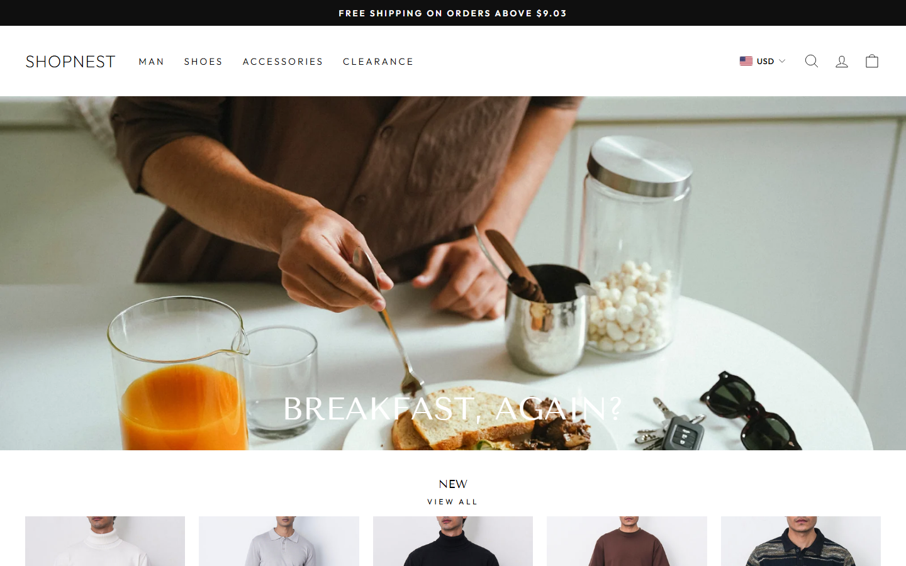
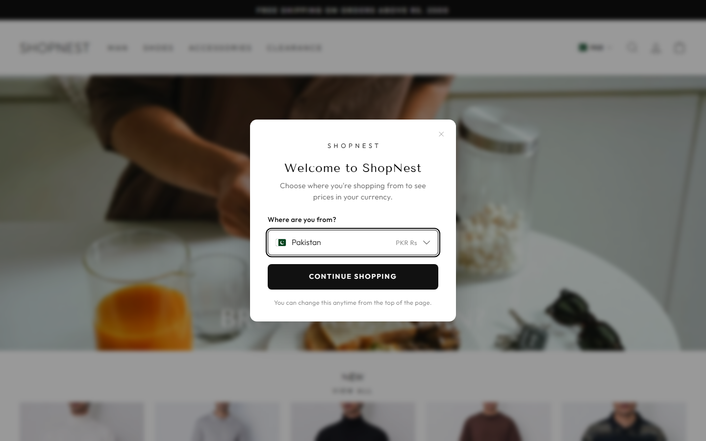
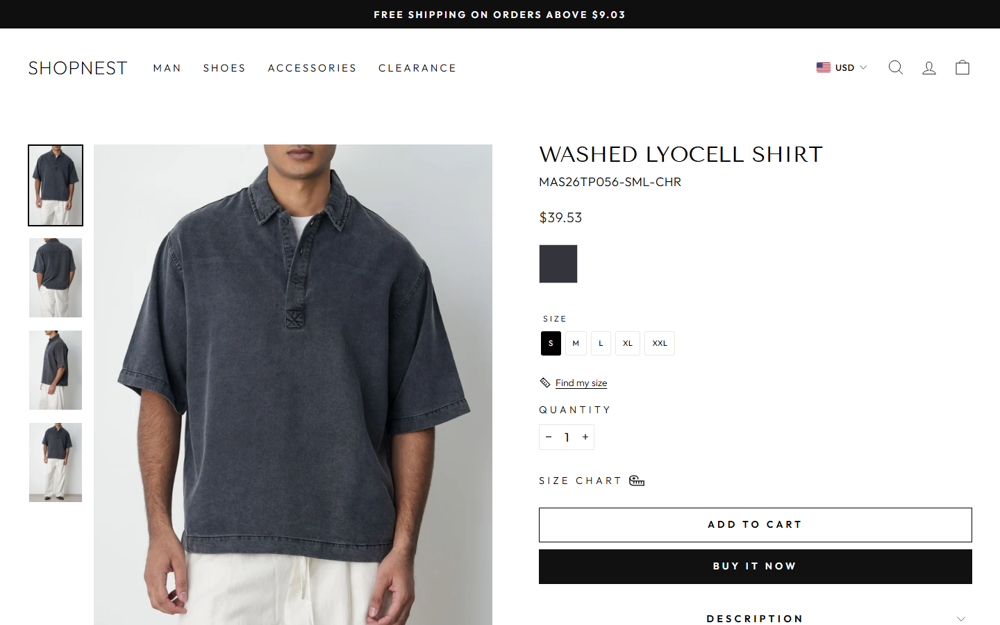
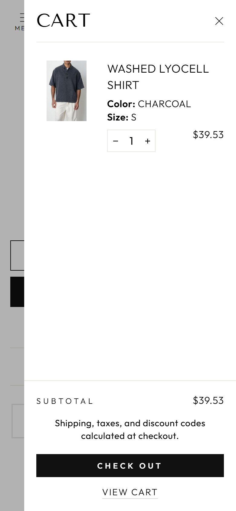
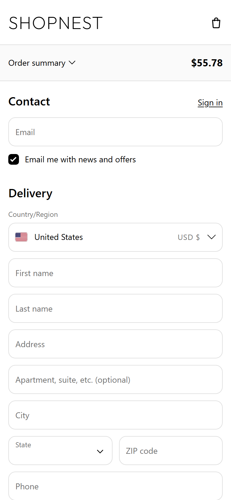

# ShopNest — MERN E-commerce Store

A full-stack fashion store with card, PayPal and cash-on-delivery checkout, live
multi-currency pricing (Rs / $ / £) and an admin panel. It is built with React,
Node/Express and MongoDB.

**Live store:** https://shopnest-three-neon.vercel.app
**API:** https://shopnest-api.vercel.app

> **Disclaimer:** ShopNest is a portfolio project. Its design and catalogue are
> modelled on the Men's section of [pk.lamaretail.com](https://pk.lamaretail.com)
> for learning purposes only. It is not affiliated with LAMA, no real products are
> sold, and payments run in test mode only.



---

## Screenshots

| Welcome popup (first visit) | Product page |
|---|---|
|  |  |

| Cart (phone) | US checkout (phone) |
|---|---|
|  |  |

---

## Features

### Shopping
- Collections with filters (size, colour, price) and sorting
- Product pages with an image gallery, size chart and a **Find My Size** helper
- Search, a slide-out cart drawer and a full cart page
- Mobile-first, responsive layout (tested down to 360px)

### Countries and currencies
- First-visit **"Where are you from?"** popup: Pakistan, USA or UK
- Prices across the store in **Rs, $ or £** using **live exchange rates**, which
  are refreshed on the server and cached at the CDN edge
- Shoppers in the US and UK are **charged in their own currency**. The total shown
  at checkout is exactly what Stripe or PayPal charges, to the cent.
- Address forms for each country:
  - US: state and ZIP code
  - UK: postcode
  - Pakistan: mobile number

### Checkout and payments
- **Stripe** card payments with server-side webhook confirmation
- **PayPal** (sandbox, live or a simulated mode for demos)
- **Cash on Delivery**, available in Pakistan only and enforced on the server
- The server re-prices every order from the database. If a price changed while
  the shopper was on the checkout page, the order is stopped (`409 PRICE_CHANGED`)
  and the shopper is asked to review it.
- Payment confirmations are rejected unless both the amount **and** the currency
  match the order.

### Customer accounts
- Register and log in (JWT), forgot/reset password
- Order history and order details, saved profile

### Admin panel
- Dashboard with sales totals
- Orders: status updates and a currency filter. Each order shows the amount
  charged and its rupee value at the locked exchange rate.
- Products: editing and image upload through Cloudinary
- Customers and contact-form messages

### Emails
- Order confirmation emails to shoppers, plus an alert to the store owner for each
  new order
- Contact-form and password-reset emails (via Brevo)

---

## Tech stack

| Layer | Technology |
|---|---|
| Frontend | React 19, Vite, React Router, Context API, plain CSS |
| Backend | Node.js 20+, Express 5, Mongoose 9 |
| Database | MongoDB Atlas |
| Payments | Stripe Checkout, PayPal Orders API |
| Services | Cloudinary (images), Brevo (email), ExchangeRate-API (currency rates) |
| Security | JWT, bcrypt, rate limiting, server-side validation |
| Hosting | Vercel (frontend and API) |

---

## Engineering highlights

- **Rupees are the single source of truth.** Prices are stored in PKR. Foreign
  amounts are computed with the exchange rate, which is **locked** on each order
  when it is placed, so reports always add up.
- **Money in minor units.** Charges are stored in cents/pence. Each item's unit
  price is rounded before it is multiplied by the quantity, so the lines always
  match the total.
- **Client and server share the same pricing logic.** A test compares the two on
  1,188 cases.
- **Defensive exchange-rate integration:**
  - a timeout on every request to the rate provider
  - a sanity range for every rate
  - a sudden jump of more than 20% is held until the next fetch confirms it
  - only one request refreshes a stale rate at a time
  - the CDN caches the rates at the edge
- **Spec-driven development.** Every feature started as a written spec, plan and
  task list. See [`docs/specs`](docs/specs).

---

## Project structure

```
ShopNest/
├── client/                 React app (Vite)
│   └── src/
│       ├── pages/          Store, checkout, account and admin pages
│       ├── components/     Layout, product, cart, currency, admin UI
│       ├── context/        Auth, cart and currency state
│       ├── api/            API calls
│       └── utils/          Pricing, validation, formatting
├── server/                 Express API
│   ├── models/             Product, User, Order, ExchangeRate, …
│   ├── controllers/        Request handlers
│   ├── routes/             API routes
│   ├── services/           Pricing, payments, emails, exchange rates
│   ├── middleware/         Auth and error handling
│   └── seed/               Catalogue seeding and admin setup
└── docs/specs/             Feature specs (001–008)
```

---

## Running locally

**Requirements:** Node.js 20+ and a MongoDB database (local or Atlas).

```bash
# 1. API
cd server
npm install
cp .env.example .env      # then fill in the values
npm run seed              # load the product catalogue
npm run admin             # create an admin user (password is typed at a prompt)
npm run dev               # http://localhost:5000

# 2. Storefront (in a second terminal)
cd client
npm install
cp .env.example .env      # VITE_API_URL=http://localhost:5000/api
npm run dev               # http://localhost:5173
```

### Environment variables (server)

| Variable | Purpose |
|---|---|
| `MONGO_URI` | MongoDB connection string |
| `JWT_SECRET` | Secret for signing login tokens |
| `CLIENT_URL` | Storefront address (used for CORS, payment return URLs and email links) |
| `STRIPE_SECRET_KEY`, `STRIPE_WEBHOOK_SECRET` | Stripe test keys |
| `PAYPAL_MODE` | `off`, `simulated`, `sandbox` or `live` (simulated needs no keys) |
| `PAYPAL_CLIENT_ID`, `PAYPAL_CLIENT_SECRET` | PayPal REST app keys (sandbox/live only) |
| `PAYPAL_USD_RATE` | Fallback Rs-per-dollar rate if live rates are unavailable |
| `BREVO_API_KEY`, `EMAIL_FROM`, `EMAIL_FROM_NAME`, `STORE_NOTIFY_EMAIL` | Email (leave the key empty to turn email off) |
| `CLOUDINARY_URL` | Image uploads in the admin panel |

Optional services switch off cleanly when their keys are empty, so the store runs
with only `MONGO_URI`, `JWT_SECRET` and `CLIENT_URL`.

To test card payments, use Stripe's test card `4242 4242 4242 4242` with any future
date and any CVC.

---

## License

This is a personal portfolio project. The code is available for viewing and
learning. Product images and branding belong to their respective owners.
